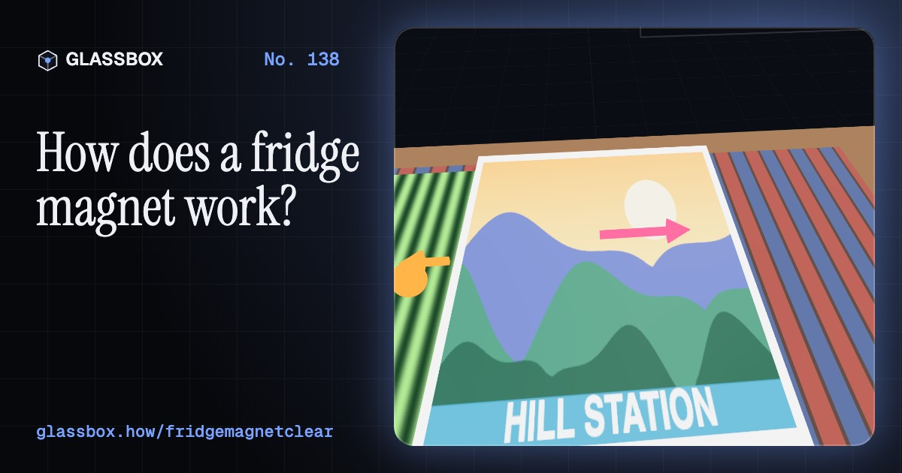
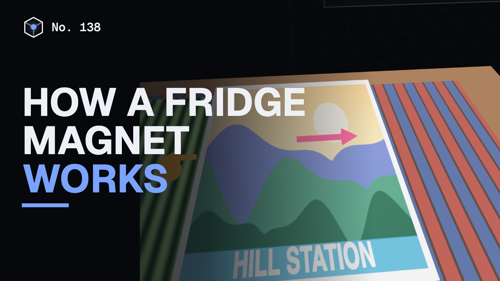
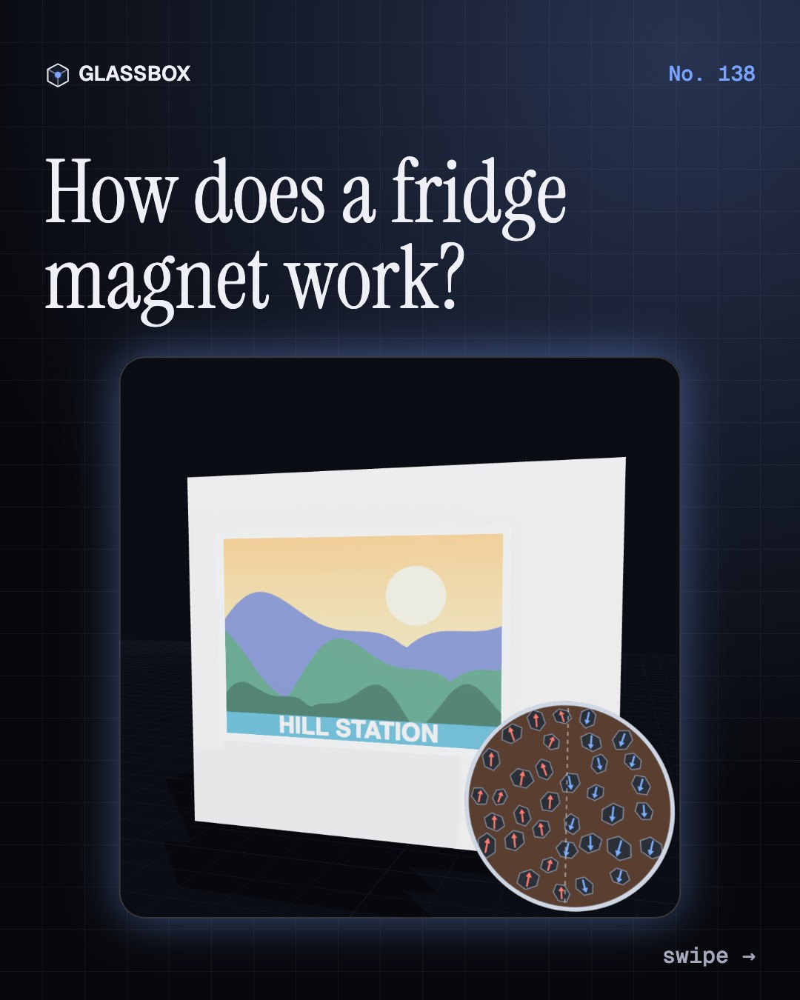
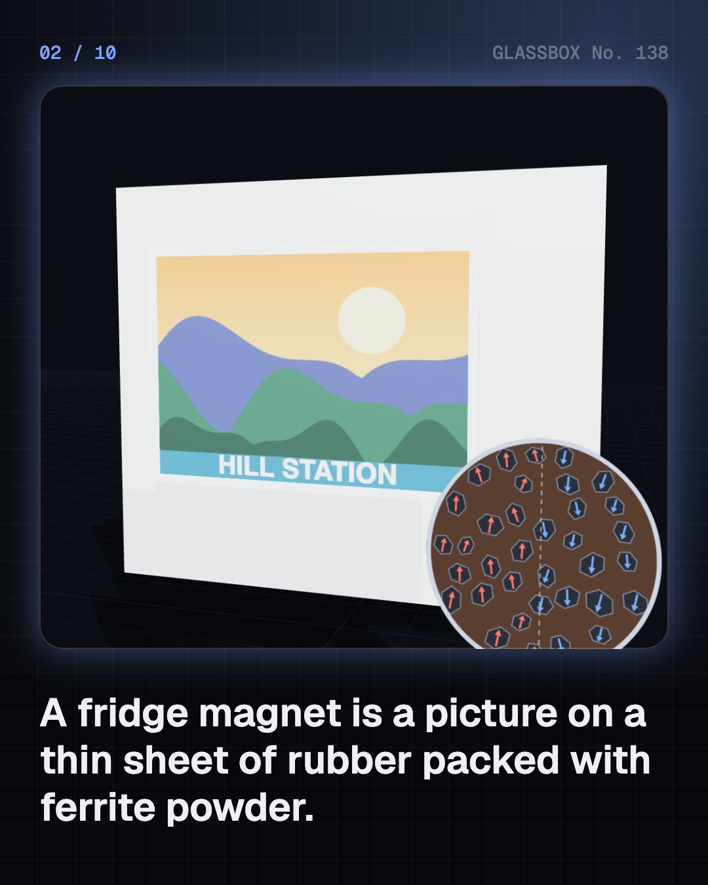
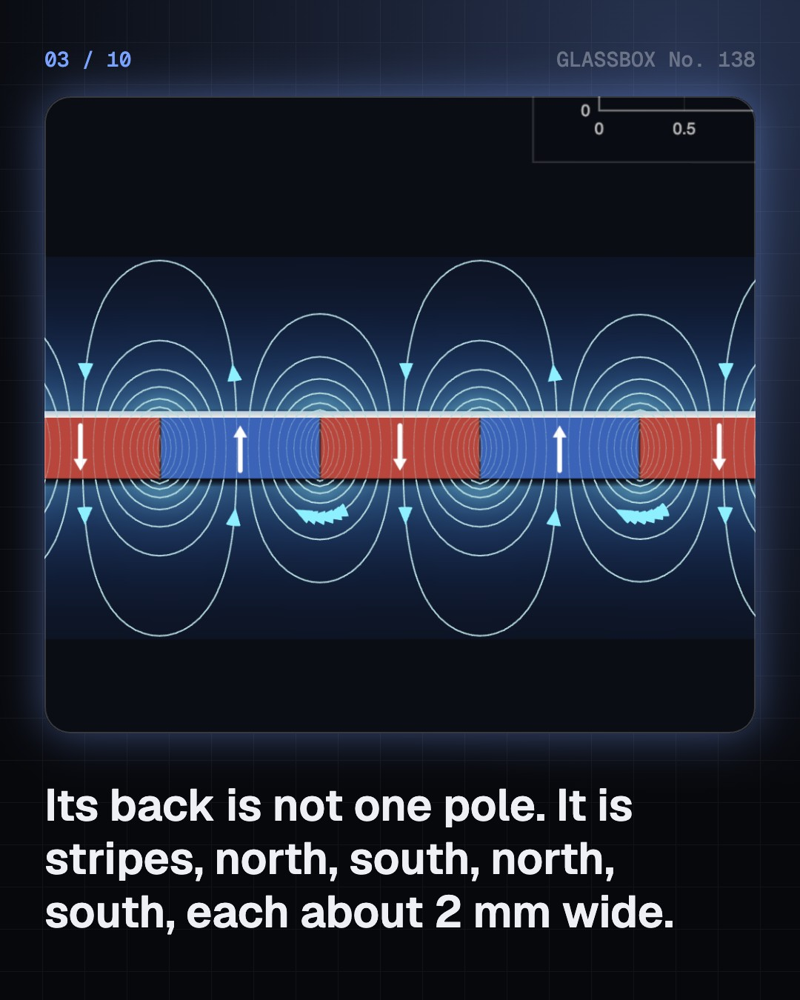
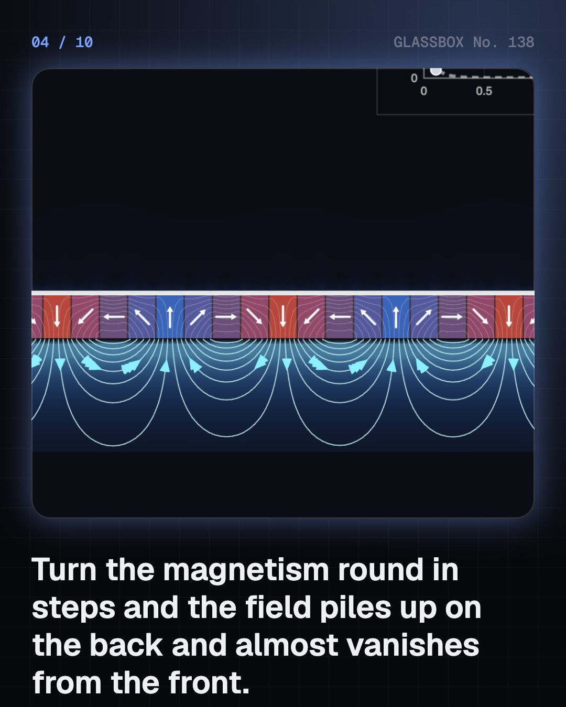

<!-- glassbox:start -->
<!-- Generated from glassbox.json by the Glassbox hub (npm run readme -- fridgemagnetclear). Edit glassbox.json, not this block. -->
<p align="center"><a href="https://glassbox.how/e/fridgemagnetclear/"></a></p>

<h1 align="center">FridgeMagnetClear</h1>

<p align="center"><b>How does a fridge magnet work?</b><br>The back of a fridge magnet is not one pole but hundreds of thin stripes, turned so that all the field comes out of one side. See the real field lines, feel why two magnets jump in steps, and run a load test to find what actually holds your shopping list up: friction.</p>

<p align="center"><a href="https://glassbox.how/fridgemagnetclear/"><b>▶ Play with it</b></a> &nbsp;·&nbsp; <a href="https://glassbox.how/e/fridgemagnetclear/">Read the 60-second explainer</a> &nbsp;·&nbsp; <a href="https://glassbox.how/fridgemagnetclear/glassbox/reel.mp4">Watch the 40-second video</a></p>

<p align="center">
  <a href="https://glassbox.how/e/fridgemagnetclear/"></a>
  <a href="https://glassbox.how/e/fridgemagnetclear/"></a>
  <a href="LICENSE"></a>
  <a href="LICENSE-CONTENT.md"></a>
  <a href="#privacy"></a>
</p>

## In 60 seconds

1. **Rubber packed with ferrite powder.** A flat fridge magnet is a printed picture on a dark sheet less than a millimetre thick. The sheet is ferrite powder, a magnetic ceramic, bound in rubber or soft plastic. Each grain is a tiny magnet, and the factory lines them up in narrow stripes.
2. **Stripes that turn: the one-sided trick.** The back is not one north pole. It is stripes about 2 mm wide, north, south, north, south, with the magnetism turning step by step in between. That pattern, a Halbach array, adds the field up on the back and nearly cancels it on the printed front.
3. **You can feel and see the stripes.** Slide two fridge magnets back to back and they jump along in steps of about 4 mm, as the stripes attract, repel and attract again. A green magnetic viewing film shows a bright line at every boundary between stripes.
4. **The steel door becomes a mirror magnet.** A fridge door is painted steel. The stripes line up the magnetic domains in the steel so it becomes a mirror image of the magnet, and the two pull together. The field of narrow stripes fades fast: the pull halves about every 0.2 mm of gap, and it does nothing on aluminium or 304 stainless steel.
5. **Friction does the lifting.** The magnet pulls into the door, not upwards. That squeeze makes friction, and friction, roughly a third of the pull, is what carries the weight. Add sheets of paper and the pull collapses while the weight grows, until everything slides.
6. **Hard magnets reach further.** A ceramic or neodymium disc has one pole on each face, so its field reaches centimetres instead of millimetres. Fridge magnets do not raise your electricity bill or wipe your phone. Small strong magnets are dangerous if swallowed, and should be kept 15 cm from a pacemaker.

## Words worth knowing

| Term | Meaning |
|---|---|
| **Ferrite** | A dark magnetic ceramic made from iron oxide with strontium or barium. Cheap, rust-proof, and the powder inside flexible magnets. |
| **Flexible magnet** | Ferrite powder, up to about 90% by weight, bound in rubber or plastic so the magnet bends and cuts with scissors. |
| **Pole pitch** | The distance from a north stripe to the next south stripe on the back of the sheet: about 2 mm. |
| **Halbach array** | Magnets whose direction turns step by step, so the field is strong on one side and nearly zero on the other. |
| **Ferromagnetic** | Describes materials like iron and most steel, whose magnetic domains line up near a magnet so that it pulls them. |
| **Domain** | A tiny region inside iron or steel in which all the atomic magnets point the same way. |
| **Coefficient of friction** | The most friction two surfaces can give, as a fraction of the force pressing them together. About 0.3 for paper on a painted door. |
| **Neodymium magnet** | The strongest kind of permanent magnet, made of neodymium, iron and boron. A button-sized disc pulls with over a kilogram. |
| **Curie point** | The temperature above which a magnet loses its magnetism for good. About 450 °C for ferrite. |

## A short history

**2,600 years from a stone that pulls iron to a printed sheet of stripes that holds up the shopping list.**

- **600 BCE** · A stone that pulls iron (Thales of Miletus (credited), Miletus, Ionia)
- **1088** · The magnetic needle, written down (Shen Kuo, Zhenjiang, China)
- **1600** · The Earth itself is a magnet (William Gilbert, London, England)
- **1906** · Domains: tiny magnets inside iron (Pierre-Ernest Weiss, Zurich, Switzerland)
- **1927** · A steel box in the kitchen (General Electric, Schenectady, New York, USA)
- **1930** · Ferrite: a magnet made of rust (Yogoro Kato and Takeshi Takei, Tokyo, Japan)
- **1952** · Ferroxdure: the cheap permanent magnet (J. J. Went, G. W. Rathenau, E. W. Gorter and G. W. van Oosterhout, Eindhoven, Netherlands)
- **1956** · The flexible magnet strip (Max Baermann, Bensberg, near Cologne, Germany)

The full story, with 30 moments, charts, people and 34 sources: [glassbox.how/e/fridgemagnetclear/history](https://glassbox.how/e/fridgemagnetclear/history/). The data lives in [`history.json`](history.json).

## Video and slides

Made with the Glassbox studio from this box's storyboard (`window.glassbox.director`). Free to reuse under CC BY 4.0.

<a href="https://glassbox.how/fridgemagnetclear/glassbox/video.mp4"></a>

<p><a href="glassbox/slide-1.jpg"></a> <a href="glassbox/slide-2.jpg"></a> <a href="glassbox/slide-3.jpg"></a> <a href="glassbox/slide-4.jpg"></a></p>

| File | What | Size |
|---|---|---|
| [`glassbox/reel.mp4`](https://glassbox.how/fridgemagnetclear/glassbox/reel.mp4) | Reel / Short, with captions and soundtrack | 1080×1920 |
| [`glassbox/video.mp4`](https://glassbox.how/fridgemagnetclear/glassbox/video.mp4) | YouTube video, with captions and soundtrack | 1920×1080 |
| `glassbox/slide-1…10.jpg` | Instagram carousel | 1080×1350 |
| `glassbox/thumb.jpg` | YouTube thumbnail | 1280×720 |
| `glassbox/cover.jpg` | Share card and repo social preview | 1200×630 |
| [`glassbox/history-reel.mp4`](https://glassbox.how/fridgemagnetclear/glassbox/history-reel.mp4) | “History in 10 moments” Reel / Short | 1080×1920 |
| `glassbox/history-slide-*.jpg` | History carousel | 1080×1350 |
| `glassbox/post.json` | Post copy and schedule used by the publish kit | |

## Privacy

This box has no accounts and no ads, and it ships its own fonts and libraries. When you run it yourself it sends nothing anywhere. On glassbox.how, the site's `/bar.js` also loads Glassbox's analytics: **Google Analytics** to count visits (it asks first in the EU, UK and Switzerland, and stays off when your browser sends Global Privacy Control or Do Not Track) and **ClickTrust** to detect bots.

It remembers a few things **in your own browser only**, and never sends them anywhere:

| Browser storage key | What it holds |
|---|---|
| `fridgemagnetclear.v1` | Which chapters you have opened, your best quiz scores, and sound on or off. |

Exactly what each one sees is at [glassbox.how/privacy](https://glassbox.how/privacy/).

## Licences

- **Code:** [MIT](LICENSE). Use it, change it, ship it.
- **Explanations, text, images and videos** (`glassbox.json`, `glassbox/`): [CC BY 4.0](LICENSE-CONTENT.md). Credit “Glassbox, glassbox.how/e/fridgemagnetclear”.
- **Third-party parts** keep their own licences: [three.js](https://threejs.org) (MIT), [Geist, Instrument Serif](https://openfontlicense.org) (SIL OFL 1.1).
- The Glassbox name and logo aren't covered by either licence. See the [terms](https://glassbox.how/terms/).

Found a mistake? [Open an issue](https://github.com/bdeeps/fridgemagnetclear/issues). Corrections happen in public.
<!-- glassbox:end -->

## Run it

It's plain HTML, CSS and JavaScript. No build step and no dependencies. Run locally, it contacts no other website.

```bash
python3 -m http.server 8000
```

Three.js and the fonts ship in `vendor/` and `fonts/`, so it also works offline.

Then open http://localhost:8000.

## How it's built

| File | What |
|---|---|
| `index.html`, `css/app.css` | The page and its styles |
| `js/app.js`, `js/stage.js`, `js/ui.js`, `js/kit.js` | The shared Glassbox 3D engine: chapters, 3D stage, controls, quiz, video director |
| `js/field.js` | The physics, with no drawing: the exact field of the magnet's stripes (summed current sheets), the steel door as a mirror image, pull, friction and disc magnets |
| `js/fridgemagnet.js` | Shared 3D parts: field lines as contours of flux, the cross-section of the sheet, chart boards |
| `js/chapters/*.js` | One file per chapter: the 3D model, controls, text, key terms, quiz and video scenes |
| `glassbox.json` | Title, question, explainer beats, key terms, browser storage and credits shown on glassbox.how |
| `reel` in each chapter | The storyboard the Glassbox studio records into short videos |
| `glassbox/` | The published video, slides, thumbnail and post copy |
| `fonts/`, `vendor/three/` | Self-hosted Geist and Instrument Serif (SIL OFL 1.1) and three.js (MIT) |
